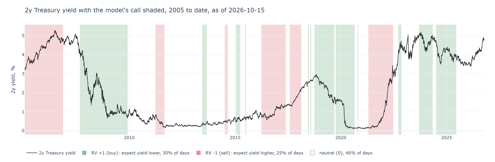
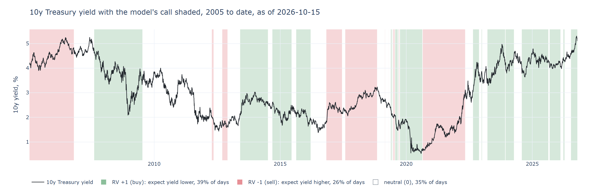

<div align="center">

# predict-ust

[](https://www.python.org/downloads/)
[](#setup)
[](https://fred.stlouisfed.org/)
[](#tests)
[](notebook/UST_RV_Score.ipynb)

**[The Model](#the-model)** &nbsp;&middot;&nbsp; **[Factors](#factors)** &nbsp;&middot;&nbsp; **[Performance](#performance)** &nbsp;&middot;&nbsp; **[Setup](#setup)** &nbsp;&middot;&nbsp; **[Usage](#usage)** &nbsp;&middot;&nbsp; **[Layout](#layout)**

## A point-in-time macro score for the direction of 2y and 10y Treasury yields over the next six months

</div>

<br>

Each day the model reads 46 macro, policy, supply, valuation, positioning and market factors, scores how hard each one is pushing yields up or down relative to its own 10-year history, and rolls them into one composite per tenor. The composite maps to a call:

| Output | Meaning |
|---|---|
| **RV +1** | Expect the yield lower over the next 6 months (buy duration) |
| **RV 0** | No call |
| **RV -1** | Expect the yield higher over the next 6 months (sell duration) |

Both tenors are scored independently, so the pair also implies a curve view (steepener, flattener or none).

<p align="center">
  
</p>

## The Model

**Point in time.** Every input is taken as it was known on the day. Revised series come from ALFRED vintages, release lags are respected, and nothing in the score uses data published after the scoring date. This is what makes the backtest an honest record of what the model would have said.

**Scoring pipeline.**

1. **Factor z.** Each factor is standardized against a rolling 10-year window (5-year minimum) and clipped at +/-3.
2. **Pressure.** The z is signed so that positive pressure means yields lower: `pressure = sign * z`. Signs are set from economic priors, not fitted.
3. **Themes.** Factors are averaged into 8 themes, and each theme is re-standardized so no theme dominates through volatility alone.
4. **Composite.** Themes are combined with tenor-specific weights (inflation and Fed weigh more on the 2y, supply and valuation more on the 10y), and the result is standardized again.
5. **Decision.** Hysteresis on the composite: enter a call when |z| reaches 0.50, exit to neutral when |z| falls below 0.25. This keeps the call from flickering around a single threshold.

**Explainability.** The composite decomposes exactly into one term per factor plus constants, so every call traces back to the factors driving it. The notebook shows this for today and for the change versus three months ago.

## Factors

46 factors in 8 themes. Four of them (priced policy path, surprise index, MOVE, swap spread) need Bloomberg, so the free-data build runs on 42. Definitions, sources and signs are in [`ust_rv/config/factors.yaml`](ust_rv/config/factors.yaml).

| Theme | Factors | 2y weight | 10y weight | What it captures |
|---|:---:|:---:|:---:|---|
| Growth | 6 | 1.00 | 1.00 | GDPNow, CFNAI, industrial production, retail sales, permits, surprise index |
| Labor | 5 | 1.25 | 1.00 | Payrolls, Sahm rule gap, claims, openings per unemployed, hourly earnings |
| Inflation | 6 | 1.50 | 1.25 | Core PCE, core CPI, trimmed-mean PCE, 5y5y breakeven, UMich expectations, oil |
| Fed | 5 | 1.50 | 1.00 | Real policy rate, priced 1y policy path, balance sheet, reserves, NFCI |
| Supply | 6 | 0.25 | 1.00 | Deficit, 2y and 10y auction demand, coupon issuance, dealer inventory |
| Valuation | 6 | 1.00 | 1.25 | 2y and 10y term premium, fair value residual, real yield, 2y vs fed funds, swap spread |
| Momentum | 6 | 0.75 | 0.75 | 12m-1m yield momentum, 10y vs 200d average, CFTC leveraged fund positioning, MOVE |
| Global | 6 | 0.75 | 1.00 | Bund and JGB yields, broad dollar, credit spreads, VIX, copper |

**Data sources:** FRED and ALFRED, TreasuryDirect, CFTC Traders in Financial Futures, NY Fed. All free. A Bloomberg provider is planned in [`PHASE4_PLAN.md`](PHASE4_PLAN.md).

## Performance

Walk-forward, out of sample, 2005 to date. P&L is a duration overlay on the call including carry and roll. Confidence intervals are block-bootstrapped and t-stats are HAC.

| | 2y model | 2y always long | 2y momentum | 10y model | 10y always long |
|---|:---:|:---:|:---:|:---:|:---:|
| IC with 6m yield change | 0.53 | | | 0.18 | |
| IC HAC t-stat | 3.8 | | | 1.5 | |
| Overlay Sharpe | 0.71 | 0.18 | 0.76 | 0.26 | 0.21 |
| Sharpe 95% CI | 0.31 to 1.13 | | | -0.12 to 0.70 | |
| Hit rate when in a call | 78% | 46% | 64% | 58% | 50% |
| P&L, bp per year | 44 | 13 | 57 | 19 | 18 |
| Max adverse move, bp | 88 | 279 | 263 | 171 | 207 |
| Neutral share of days | 46% | 0% | 1% | 35% | 0% |
| Average hold, days | 156 | | 37 | 132 | |

**How to read it.** The 2y call is the stronger signal. Its IC is significant, and it earns a Sharpe close to pure momentum while taking far smaller adverse moves and trading about 2 times a year rather than 9. The 10y call has a positive but statistically weak edge and should be treated as low conviction. Robustness checks (placebo composites with random factor signs, non-overlapping IC, nested walk-forward threshold selection) are in the notebook.

<p align="center">
  
</p>

## Setup

Requires Python 3.13 and a free [FRED API key](https://fred.stlouisfed.org/docs/api/api_key.html).

```powershell
py -3.13 -m venv .venv
.venv\Scripts\Activate.ps1
pip install -r requirements.txt
pip install -e .
python -m ipykernel install --user --name ust_rv
```

Create `.env` in the repo root:

```
FRED_API_KEY=your_key_here
```

The first run downloads and caches all series under `cache/`. Later runs fetch only what is new.

## Usage

**Notebook.** Open [`notebook/UST_RV_Score.ipynb`](notebook/UST_RV_Score.ipynb) with the `ust_rv` kernel and Run All (about 75 seconds with a warm cache). It opens with today's calls, then the factor and theme drivers, the yield history with calls shaded, the performance scorecard and the robustness checks.

**Headless HTML report.**

```powershell
jupyter nbconvert --to html --execute --ExecutePreprocessor.kernel_name=ust_rv notebook\UST_RV_Score.ipynb
```

**From Python.**

```python
from ust_rv.runner import run

result = run(with_backtest=True)
print(result.signal)
```

**Threshold calibration.**

```powershell
python -m ust_rv.backtest.calibrate
```

## Tests

```powershell
pytest -m "not network"   # offline suite, 151 tests
pytest                    # full suite including live data checks, 164 tests
```

## Layout

| Path | Contents |
|---|---|
| `ust_rv/config/` | `factors.yaml` (factor definitions and signs), `settings.yaml` (windows, thresholds, theme weights) |
| `ust_rv/providers/` | FRED, ALFRED and other data clients with local caching |
| `ust_rv/realtime.py` | Point-in-time alignment of vintages and release lags |
| `ust_rv/panel.py` | Builds the daily factor panel |
| `ust_rv/features/` | Factor transforms and rolling z-scores |
| `ust_rv/scoring/` | Pressure, themes, composite and the hysteresis decision |
| `ust_rv/backtest/` | Walk-forward engine, overlay P&L, metrics, bootstrap, robustness, calibration |
| `ust_rv/runner.py` | One call that produces today's signal and, optionally, the backtest |
| `ust_rv/report.py` | Charts and tables used by the notebook |
| `notebook/` | The model report |
| `tests/` | Unit and integration tests |

<br>

> **Disclaimer.** This is a research model built on public data. Backtest results are hypothetical. Nothing here is investment advice.
